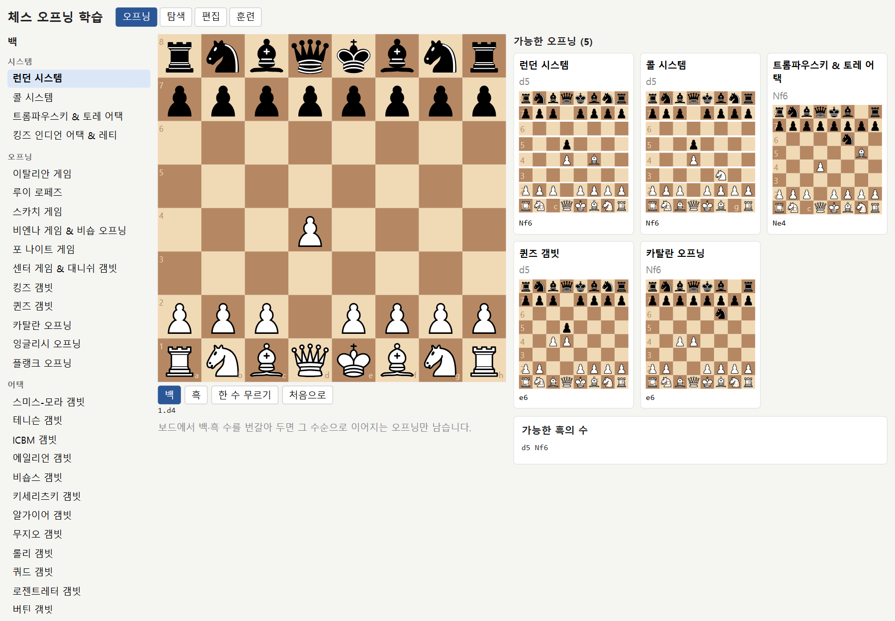
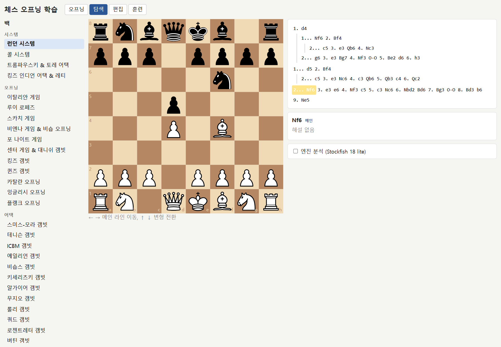

# 체스 오프닝 학습

백/흑 → 시스템·오프닝·어택 / 디펜스·시스템·카운터 → 오프닝 → 수 트리 구조로 이론 수와 변형을 학습하는 개인용 웹.

## 스크린샷

**오프닝 모드**: 1.d4를 두면 이어지는 오프닝 5개가 미니 보드 카드로 나오고, 아래에 가능한 흑의 수가 붙습니다.



**탐색 모드**: 오프닝별 수 트리와 해설을 보며 ← → ↑ ↓ 키로 이동합니다.



## 설치 · 실행

Node.js 22.12 이상이 필요합니다 (Vite 8 · Vitest 5 요구사항).

```bash
git clone https://github.com/do-gongil/chess-opening-trainer.git
cd chess-opening-trainer
npm install
npm run dev      # http://localhost:5173
```

```bash
npm test         # vitest (model 순수 함수 + 시드 합법성)
npm run lint     # oxlint
npm run build    # dist/ 정적 배포물
```

## 엔진 배치 (선택)

엔진 분석 기능은 Stockfish 18 lite (단일 스레드 WASM) 를 씁니다.
GPLv3 바이너리라 이 저장소에 포함하지 않았으므로, npm 의 [`stockfish`](https://www.npmjs.com/package/stockfish)
패키지에서 두 파일을 꺼내 `public/engine/` 에 둡니다 (저장소 루트에서, bash / Git Bash):

```bash
npm pack stockfish@18.0.8
tar -xzf stockfish-18.0.8.tgz package/bin/stockfish-18-lite-single.js package/bin/stockfish-18-lite-single.wasm
mkdir -p public/engine
mv package/bin/stockfish-18-lite-single.* public/engine/
rm -r package stockfish-18.0.8.tgz
```

`public/engine/` 은 `.gitignore` 에 들어 있어 커밋되지 않습니다.
두 파일이 없어도 앱은 정상 동작합니다. 엔진 체크박스만 비활성 상태가 됩니다.

## 모드

- **오프닝**: 백/흑을 고르고 보드에서 수를 두면(예: 1.d4) 그 수순으로 이어지는 그 색 오프닝이 미니 보드 카드로 나타나 이후 메인 라인을 반복 재생한다. 카드를 누르면 탐색 모드에서 해당 국면이 열린다. 카드 아래에는 지금 둘 차례에 맞춰 이어서 둘 수 있는 수가 '가능한 백의 수' / '가능한 흑의 수'로 나온다.
- **탐색**: 오프닝 목록 → 수 트리 클릭 / ← → ↑ ↓ 키로 이동. 보드에서 이론 수를 두면 따라간다.
- **편집**: 보드에서 수를 두면 트리에 추가. 해설 입력, 메인으로 승격, 서브트리 삭제, 오프닝 추가/삭제. 내보내기/가져오기(JSON), 시드 초기화.
- **훈련**: 상대 수는 무작위 변형으로 자동, 내 차례에 이론 수 맞히기. 1차 오답은 출발 칸 힌트, 2차 오답은 정답 표시 후 진행.
- **엔진**: 체크박스로 Stockfish 18 lite(단일 스레드 WASM, `public/engine/`) 분석. 평가는 항상 백 기준.

## 데이터

- 저장: `localStorage['chess-study.library']`. 첫 실행 시 `src/data/seed.ts` 적재.
- 구조: `Library { version: 1, openings: Opening[] }`, `Opening { id, color, category, name, description, root, nodes }`, `MoveNode { id, parent, san, fen, comment, children }`. `children[0]`이 메인 라인.
- 시드 추가: `seed.ts`의 `lines`에 SAN 라인을 공백 구분 문자열로 넣는다. 첫 줄이 메인, 나머지는 공통 접두어에서 분기. 불법 수는 `npm test`에서 잡힌다.

## 관련 오프닝 연결

오프닝 시작 국면(루트) 패널에 **대응하는 흑 디펜스·갬빗** / **맞서는 백 시스템·오프닝·갬빗** 칩이 표시된다. 시드의 `related` 배열(오프닝 이름)에서 오며 한쪽에만 적혀 있어도 양방향으로 보인다. 편집 모드에서 쉼표 구분으로 직접 수정할 수 있다. 시드 구성은 chess.com "Learn the Openings" 코스의 50개 레슨을 가족별로 묶고 파생 오프닝을 더한 것(백 27, 흑 25). 오프닝 이름 표기와 기준 수순은 나무위키 「오프닝(체스)」 문서와 대조했다. 테니슨 갬빗과 ICBM 갬빗(테니슨의 트랩 라인)은 나무위키 「레티 오프닝」 문서 기준이다. 스미스-모라 갬빗 대응(흑)은 나무위키 「스미스-모라 갬빗」의 포메이션 분류와 chess.com 오프닝 페이지 기준이다. 킹즈 갬빗 파생(비숍스·키세리츠키·알가이어·무지오·롤리·쿼드·로젠트레터·버틴 갬빗과 킹즈 갬빗의 샬로프·커닝햄·베커 디펜스 라인)은 나무위키 「킹즈 나이트 갬빗」·「킹즈 갬빗 수락」의 분류와 영문 위키백과 King's Gambit 문서, Lichess chess-openings 데이터의 수순·이름 기준이다.

## Stack

`React 19` `TypeScript` `Vite` `Vitest` `chess.js` `react-chessboard` `oxlint`

## License

MIT — `LICENSE` 참조. `public/engine/` 의 Stockfish 는 별도 GPLv3 저작물이며 이 저장소에 포함되지 않습니다.
